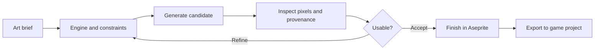

# Game Design Document

**Release note:** OTA support and basic reference-preservation checks passed in private 0.3.1 candidates; free cryptographically signed OTA updates are being verified for 0.3.2. Draft releases are not offered by the updater.

**Product:** Aseprite AI Studio · **Document baseline:** 18 November 2026 · **Audience:** solo game developers, pixel artists, technical artists and assistant-driven creation workflows.

## High concept

A desktop workshop that turns an art brief into inspectable, editable game assets. AI provides candidate artwork; the artist controls selection, revisions, size, palette and final acceptance. Local generation is the default, optional cloud use is explicit, and assets remain accessible as PNG, JSON and native Aseprite projects.

The experience borrows a game’s clear feedback loop—choose a goal, perform a meaningful action, inspect the result, improve the artifact—without points, artificial scarcity or paid progression. Success is a usable asset, not the number of images generated.

## Design pillars

| Pillar | Product behavior | Failure to avoid |
|---|---|---|
| Artist ownership | Originals and revisions remain editable; imports create new editor documents | Overwriting an existing sprite or disguising a failed generation |
| Local by default | ComfyUI and Ollama are explicit engines; no automatic cloud fallback | Unexpected uploads or charges |
| Evidence over appearance | Preview actual pixels and animation frames | Calling an animation consistent merely because it plays |
| One workspace, several entry points | Desktop, web UI, native panel and MCP share the backend contract | Separate libraries with contradictory state |
| Understandable controls | Custom styled dropdowns, checkboxes and sliders, keyboard operation and actionable errors | Unstyled browser widgets or unexplained disabled actions |

## Users and jobs

- **Solo developer:** create a character or prop, revise it, and export it into a game project without learning an image-generation graph editor.
- **Pixel artist:** use AI as a starting point, reduce the image to a deliberate grid/palette, and finish manually in Aseprite.
- **Technical artist:** generate bounded batches, inspect model provenance and export state/direction metadata.
- **Assistant user:** ask an MCP client to inspect installed models, create candidates, show real previews and export accepted results.

## Core creation loop

The acceptance decision belongs to the artist. Rejected work can be retained for comparison; the app does not silently delete user artwork. No automatic paid retries are allowed.

## Workspace and interaction design

The asset library is the stable navigation anchor. The center contains the preview, original/pixel toggle, playback and export actions. The creation panel contains the prompt, subject type, style, engine/model, size and palette. Animation options expand when requested instead of taking over every still-image task.

Primary actions: Generate artwork, Use as reference, Apply pixel changes, Open in Aseprite, Export. Loading, empty, queued, running, failed, cancelled and completed states must be distinguishable. Errors should explain the next useful action, not expose stack traces or provider credentials.

Keyboard behavior includes focus visibility, arrow keys in custom selectors/sliders, Space for checkboxes, Escape to close the nearest popup first, and focus restoration when a dialog closes. Native text-entry semantics are retained with a custom appearance. OS file dialogs remain available for choosing files.

## Content and asset types

| Type | Inputs | Outputs | Acceptance concern |
|---|---|---|---|
| Character | Description, style and optional reference | PNG, editable sprite | Recognizable silhouette, anatomy, palette, identity |
| Object | Description and optional reference | PNG, editable sprite | Readability and scale |
| Tile | Terrain/material brief | PNG tile | Seamless edges must be checked; prompt preset does not guarantee tiling |
| Scene | Composition and mood | PNG background | Spatial readability and camera consistency |
| Animation | Still reference, state, direction, frames and FPS | Sheet, JSON, tagged timeline | Identity, motion, timing, facing and hand placement |

## Animation system

Available state controls: **idle, walk, run, attack, hurt, death, jump**. Available directions: **south, south-west, west, north-west, north, north-east, east, south-east**. Each state/direction pair becomes a clip and a sheet row. Frames progress left to right.

Per clip: 2–8 frames; playback: 1–24 FPS. The current app allows at most 32 total frames and 8,388,608 total frame pixels per job. At 1024×1024, this permits eight total frames. Generate additional states or directions as separate jobs. Cancellation or failure does not publish a partial animation.

The built-in local animation path uses reference-conditioned ComfyUI calls with pose/phase prompts. Character preservation adds an IP-Adapter for the original reference, a fixed seed and local per-frame vision review. Missing dependencies or a failed/uncertain review reject the sequence. Disabling preservation produces an unverified draft. Identity checks do not establish correct motion. It is **experimental**: temporal consistency, precise anatomy and requested facing are not guaranteed. Ollama is used only for local identity review, not image synthesis; cloud animation is not enabled through this generation path. A higher-resolution image does not fix a model’s motion errors.

An AI-generated coherent sheet produced with an external built-in image tool was added as a reviewed example. That one-off asset does not imply that the desktop app includes that tool as a provider. Its provenance remains distinct from the local generation engine.

## Reference scenario: jump while drawing a sword

The character has a scabbard at the anatomical left hip. The anatomical right hand crosses the torso, grips the hilt, and draws the sword during takeoff. The left hand stabilizes the scabbard. The blade clears at the jump apex, stays in the right hand on descent, and remains drawn after landing.

Suggested beats: standing anticipation → crouch and grip → push off/partial draw → rising/half draw → apex/full draw → descend → absorb landing → recovered guard. Use one fixed camera and one ground baseline; do not recenter each frame and erase the jump arc.

Acceptance checklist: same character, clothing, proportions and weapon; one sword and scabbard; correct anatomical hand; plausible blade extraction; visible airborne phase; stable camera; meaningful landing. A failed model output must be labelled a draft. Do not substitute procedural drawings while claiming AI generation.

## Rules, economy and progression

There is no in-app virtual economy, combat system, player character progression or marketplace. Engine compute and provider billing are real operational costs. The desktop app does not purchase models, spend cloud credit automatically, or assume that a consumer chat subscription grants API access.

Progress is artifact-based: initial brief, candidate, revised asset, accepted asset, exported game-ready package. These are workflow concepts; a formal review/status system is **planned**, not currently enforced by a database.

## Audio and motion

No music, sound effects or voice synthesis is included. UI motion should remain restrained and respect reduced-motion preferences. Animation preview is a review tool, not a game runtime or proof of production-ready motion.

## Scope boundaries

Available: local image generation, local structured drawing, optional image API adapters, references, grid/palette processing, bounded animation jobs, previews, exports, new-document native import and stdio MCP.

Planned: dedicated temporal/pixel-animation provider, explicit per-frame pose controls, onion skin and contact-sheet review, frame repair, semantic background removal, deterministic seamless tiles and project-level acceptance states. No delivery dates or PixelLab quality parity are promised.
